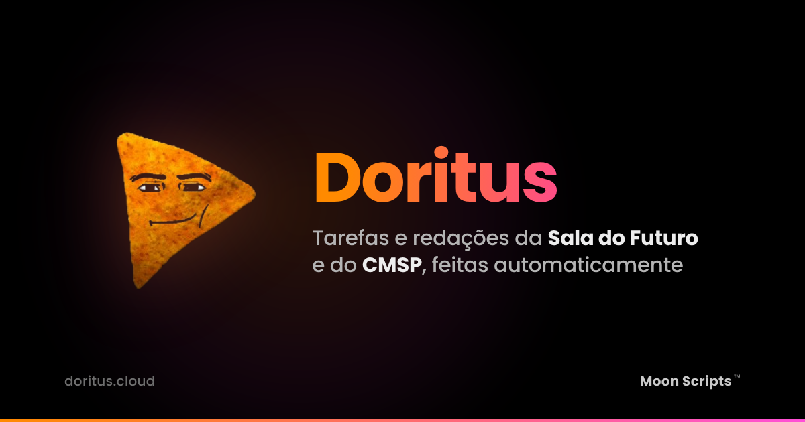

  

# Doritus Cloud

Sistema automatizado para resolver atividades e redações da plataforma [Sala do Futuro](https://saladofuturo.educacao.sp.gov.br/), focado nos estudantes do estado de São Paulo.

---

## Como Funciona:

1. Acesse o site: [https://doritus.cloud/](https://doritus.cloud/)

2. Preencha seu **RA** (Ex: `123456789xsp`) e sua **Senha**.

3. Clique no botão **"Atividades Pendentes"**.

4. Um modal listará suas tarefas. Selecione as que deseja fazer e avance.

5. No modal de configurações, defina:
   - Se deseja enviar direto ou salvar como rascunho.
   - A porcentagem de acertos desejada.
   - O tempo de espera (delay) para o envio de cada atividade.

6. Aguarde no site enquanto o sistema realiza as tarefas automaticamente.

---

## Funcionalidades Principais:

* **Atividades Pendentes**
  Resolve automaticamente suas tarefas em qualquer status (pendentes, expiradas ou em rascunho).

* **Redações Pendentes**
  Gera textos automaticamente via Inteligência Artificial e salva a redação como rascunho.

* **Correção Moon**
  Modifica as notas de atividades já entregues para a nota máxima. *(Atualmente suporta apenas atividades e redações).*

---

## Colaboração:

* **Desenvolvedor:** [hackermoon1](https://github.com/hackermoon1)

* **Moon Scripts:** [Discord](https://discord.com/invite/moonscripts)

---

## Suporte e Dúvidas

Caso tenha problemas ou dúvidas, você pode:

* Abrir uma **Issue** neste repositório do GitHub.

* Entrar no nosso **Discord** para receber suporte direto da equipe.
